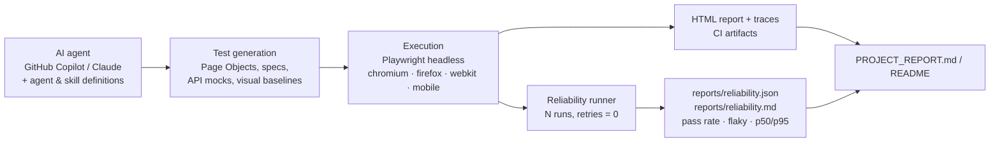

# Agentic Test Automation with Playwright

A comprehensive end-to-end test suite for the **Employee Manager** web application, built with [Playwright](https://playwright.dev/). This project was created using an AI coding agent (GitHub Copilot) to demonstrate agentic test automation — from app exploration to full test coverage, all driven by natural language instructions.

## Project Structure

```
├── .github/
│   └── workflows/
│       └── playwright.yml          # CI: e2e suite + reliability job (GitHub Actions)
├── reports/
│   ├── reliability.json            # Latest reliability run (machine-readable)
│   └── reliability.md              # Latest reliability run (human-readable)
├── PROJECT_REPORT.md               # CI + reliability measurement write-up
├── EAEmployeeWithTestSprite/
│   ├── backend/                    # Node.js + Express + SQLite API (port 4000)
│   ├── frontend/                   # React 19 + MUI v7 + Vite (port 5173)
│   └── tests/
│       ├── playwright.config.js    # Playwright configuration
│       ├── scripts/
│       │   └── reliability.js      # Repeats the suite N times, writes reports/reliability.{json,md}
│       └── e2e/
│           ├── pages/
│           │   ├── LoginPage.js          # Page Object Model
│           │   └── EmployeeListPage.js   # Page Object Model
│           ├── login.spec.js             # Login flow tests
│           ├── employees.spec.js         # Employee CRUD tests
│           ├── api-mocking.spec.js       # API mocking / error state tests
│           └── visual.spec.js            # Visual regression tests
```

## Test Coverage

| Suite | Tests | Description |
|-------|-------|-------------|
| `login.spec.js` | 10 | Login form, valid/invalid credentials, redirects, UI elements |
| `employees.spec.js` | 24 | Employee CRUD (Add, View, Edit, Delete), search, auth guards |
| `api-mocking.spec.js` | 12 | Error states, network failures, loading spinners (no live backend needed) |
| `visual.spec.js` | 11 | Screenshot regression — login, employee list, dialogs, dark mode |
| **Total** | **57 specs × 5 projects = 197 tests** | |

## Browser Coverage

| Project | Browser / Device |
|---------|-----------------|
| `chromium` | Desktop Chrome |
| `firefox` | Desktop Firefox |
| `webkit` | Desktop Safari |
| `mobile-chrome` | Pixel 7 (Android) |
| `mobile-safari` | iPhone 14 (iOS) |

> Visual regression tests run on Chromium only to keep snapshots deterministic.

## Tech Stack

- **Frontend**: React 19, MUI v7, React Router v7, Vite
- **Backend**: Node.js, Express, SQLite3
- **Test Framework**: Playwright v1.63
- **CI/CD**: GitHub Actions

## Getting Started

### Prerequisites

- Node.js 18+
- Docker (optional, for containerised run)

### 1. Start the Application

**Backend** (port 4000):
```bash
cd EAEmployeeWithTestSprite/backend
npm install
node server.js
```

**Frontend** (port 5173):
```bash
cd EAEmployeeWithTestSprite/frontend
npm install
npm run dev
```

### 2. Install Test Dependencies

```bash
cd EAEmployeeWithTestSprite/tests
npm install
npx playwright install
```

### 3. Run Tests

```bash
# Run all 197 tests across all browsers
npx playwright test

# Run a specific suite
npx playwright test e2e/login.spec.js

# Run only Chromium
npx playwright test --project=chromium

# Run with visible browser (headed mode)
npx playwright test --headed

# Update visual regression snapshots
npx playwright test --update-snapshots
```

### 4. View HTML Report

```bash
npx playwright show-report
```

## CI/CD

The GitHub Actions workflow (`.github/workflows/playwright.yml`) runs on every push and pull request (and on manual dispatch) with two jobs:

**`e2e` — full cross-browser suite**
1. Installs locked dependencies (`npm ci`) for backend, frontend and tests
2. Installs Playwright browsers with system dependencies (`npx playwright install --with-deps`)
3. Starts the backend and frontend and waits for both health checks
4. Runs the whole suite headless (`CI=true`: 2 retries, `test.only` forbidden, traces kept for every failed attempt)
5. Uploads artifacts on every run: `playwright-report` (HTML, 30 days) and `playwright-traces` (traces, screenshots, videos from `test-results/`, 14 days); server logs on failure

**`reliability` — Chromium suite repeated N times**
1. Runs `node scripts/reliability.js --runs N --project chromium --start-app` with retries disabled (N defaults to 5, settable via the manual-dispatch input)
2. Writes the Markdown summary to the job summary page and uploads `reports/` as the `reliability-report` artifact
3. Fails if any test fails in every run (consistently broken); flaky tests are reported, and can fail the job with `--fail-on-flaky`

## Reliability

Reliability is measured by running the suite several times with **retries disabled**, so that flakiness is exposed instead of masked. Every test is classified from its outcomes across runs:

| Classification | Meaning |
|---|---|
| stable | passed in every run |
| flaky | passed in some runs and failed in others |
| failing | failed in every run |

**Latest run** (2026-11-03, Chromium only, 5 runs, retries 0, Playwright 1.63.0, Node v22.23.4, Linux). Full tables: [`reports/reliability.md`](reports/reliability.md).

| Metric | Value |
|---|---|
| Tests per run | 57 |
| Test executions | 285 |
| Pass rate | **100%** (285 passed, 0 failed) |
| Stable / flaky / failing | 57 / 0 / 0 |
| Fully green runs | 5 / 5 |
| Suite duration p50 / p95 | 53.0s / 56.1s |

Slowest tests by p95:

| Test | p50 | p95 |
|---|---|---|
| `employees.spec.js` › Employee – Edit › should save edited employee and reflect the change in the list | 4.0s | 5.1s |
| `employees.spec.js` › Employee – Add › should add a new employee and show it in the list | 4.1s | 4.4s |
| `api-mocking.spec.js` › API Mocking – Loading States › should show loading indicator while waiting for employees to load | 3.0s | 3.2s |
| `employees.spec.js` › Employee – Delete › should cancel deletion and keep the employee in the list | 2.7s | 2.8s |
| `employees.spec.js` › Employee – Delete › should delete the employee and remove it from the list | 2.7s | 2.8s |

> Firefox, WebKit and the mobile projects were not measured in that run because their browsers could not be downloaded in the measurement environment; the CI `reliability` job uses the same runner on `ubuntu-latest`.

### Reproduce

```bash
# 1. start the app (or pass --start-app to the runner and skip this)
(cd EAEmployeeWithTestSprite/backend && npm ci && node server.js &)
(cd EAEmployeeWithTestSprite/frontend && npm ci && npx vite --port 5173 --strictPort &)

# 2. run the suite 5 times on Chromium and write reports/reliability.{json,md}
cd EAEmployeeWithTestSprite/tests
npm ci && npx playwright install chromium
node scripts/reliability.js --runs 5 --project chromium --out ../../reports
```

Options: `--runs N`, `--project <name>`, `--grep <regex>`, `--out <dir>`, `--start-app`, `--fail-on-flaky`, and anything after `--` is passed to `playwright test`. Durations are per attempt, percentiles use nearest-rank. The same runner backs the `reliability` CI job, so the numbers in CI and in `reports/` are produced by identical code.

### Pipeline



## Demo Credentials

| Username | Password |
|----------|----------|
| `admin` | `password` |
| `user` | `123456` |
| `test` | `test123` |

## How This Was Built

This test suite was created end-to-end by a **GitHub Copilot AI agent** given only the running application and natural language instructions:

1. **App exploration** — Playwright MCP was used to navigate the live app and understand its structure
2. **Test design** — Page Object Models, test suites, and fixtures were generated from source code analysis
3. **Debugging** — All 8 initial failures were diagnosed and fixed autonomously (strict-mode locator conflicts, race conditions, MUI-specific selector issues)
4. **Coverage expansion** — API mocking, visual regression, cross-browser config, and CI/CD pipeline added on request
5. **Git workflow** — Security scan, staging, commit, and push to GitHub all handled by the agent

> Total tests passing: **197 / 197**
